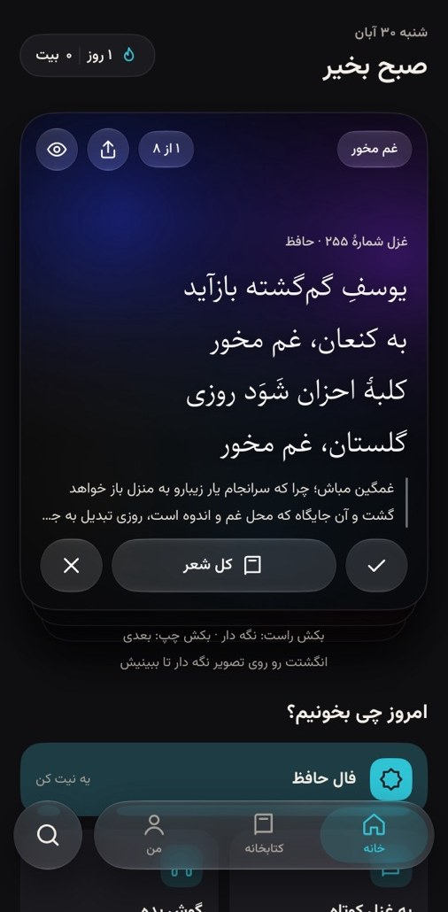
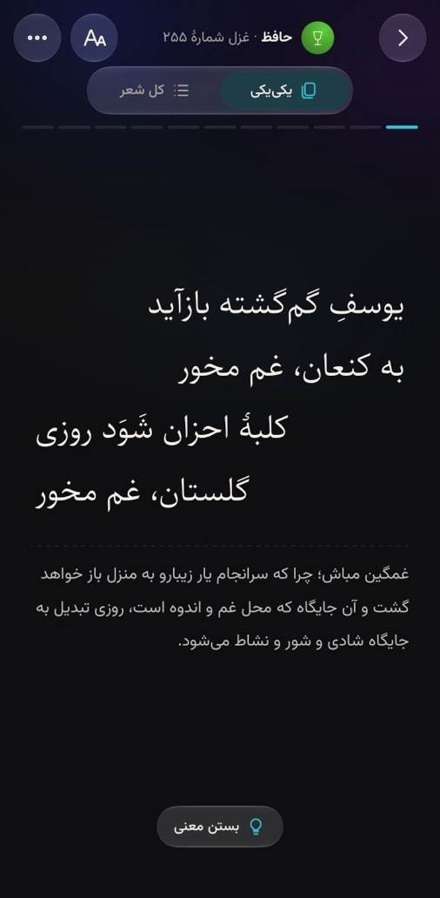
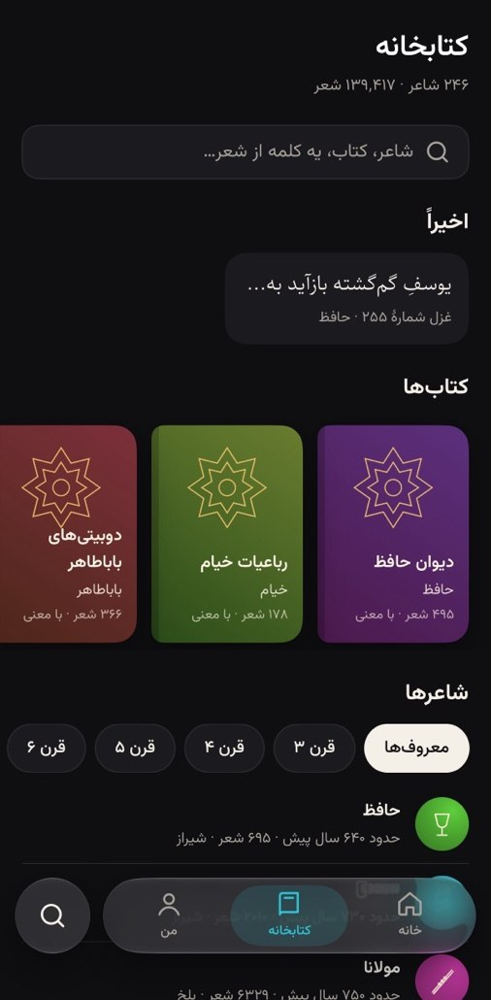
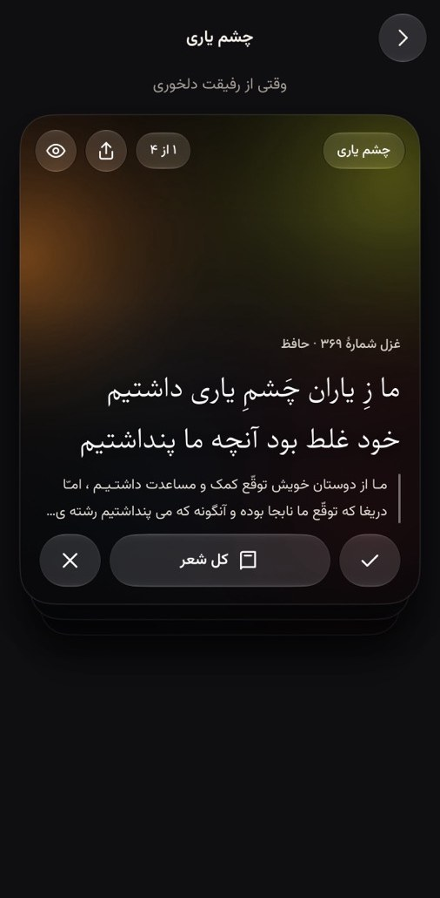
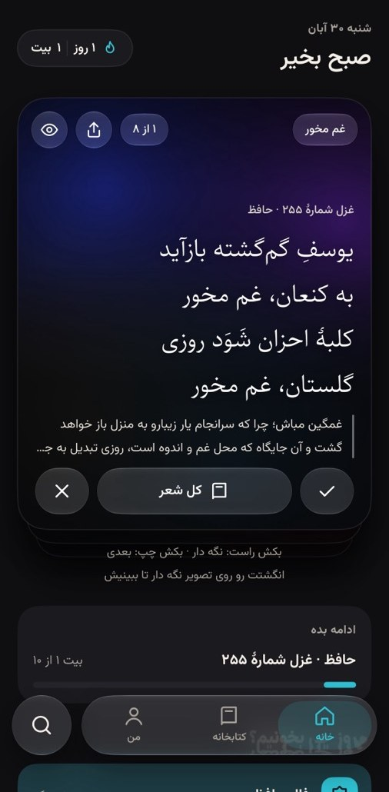

# بیت · Beyt

**A calm Persian poetry reader for iOS.** Classical Persian poetry in today's language: a daily card deck,
line-by-line meanings, real recitations that follow the text, and a full library of 246 poets.

<p>
  
  
  
  
  
</p>

## Features

- **Daily deck**: swipe right to keep a couplet, left for the next; hold to see the picture, tap to read the poem.
- **Type-art**: every couplet gets its own scene drawn out of its own letters (moon, candle, cups…), softly blurred or clean.
- **Reader**: one couplet at a time or the whole poem, simple meanings for every line, eight open-source verse fonts.
- **Recitations**: real Ganjoor recitations; the reader follows the voice hemistich by hemistich. An Apple Music style player: a mini player on every screen, a Now Playing screen with the couplets as lyrics, speed control, a choice of readers, play from any couplet, and lock-screen controls.
- **Your divan**: kept couplets in their own list, with search, poet filters and swipe to remove.
- **Library**: 246 poets. Hafez's ghazals, Khayyam's quatrains and Baba Taher are bundled with meanings;
  every other book loads on demand from Ganjoor's public data and stays on the phone.
- **Moods**, **search**, **Fal-e Hafez**, **story cards** to share, and a personal **divan** of kept couplets.
- Right-to-left throughout, dark and calm, Liquid Glass on iOS 26.

No accounts, no tracking. Social features may come later.

## Build

Requirements: Xcode 26 or later, iOS 17+, [XcodeGen](https://github.com/yonaskolb/XcodeGen) (`brew install xcodegen`).

```sh
xcodegen generate
open Beyt.xcodeproj
```

To run on a device, copy `Config/Local.xcconfig.example` to `Config/Local.xcconfig` and set your
`DEVELOPMENT_TEAM` (and, if needed, your own `PRODUCT_BUNDLE_IDENTIFIER`). That file is ignored by git.

## Project layout

```
Beyt/
  App/        app entry, navigation, tab bar
  Core/       data (Library), settings (Prefs), audio, curated content
  Art/        type-art renderer (scenes drawn from a couplet's letters)
  Features/   Home, Reader, Library, Search, Fal, Me, Onboarding, sheets
  UI/         shared components, hand-drawn line icons
  Resources/  fonts, bundled poetry data, assets
Config/       signing (your Local.xcconfig goes here)
design/       the original HTML prototype the app is based on
tools/        scripts that build the bundled data, icons and app icon
```

## Regenerating assets

```sh
python3 tools/build_data.py tools/source/data.json tools/source/allp.json tools/source/books-text.json Beyt/Resources/Data
python3 tools/build_icons.py design/prototype.html Beyt/UI/IconData.swift
swift tools/make_icon.swift Beyt/Resources/Assets.xcassets/AppIcon.appiconset/icon-1024.png
```

Debug builds accept launch arguments that open a screen directly (handy for screenshots):
`-beytSkip YES`, `-beytTab library|me`, `-beytRoute poem:<url>|mood:<key>|book:<url>|fal|search`,
`-beytSheet poet:<slug>|share:<url>|font`, `-beytQuery <text>`, `-beytStep <0-2>`.

## License

Code: [MIT](LICENSE). Fonts and poetry data keep their own terms; see
[THIRD_PARTY_NOTICES.md](THIRD_PARTY_NOTICES.md).

Poetry data from [Ganjoor](https://ganjoor.net) · [ganjoor-data](https://github.com/ganjoor/ganjoor-data).
